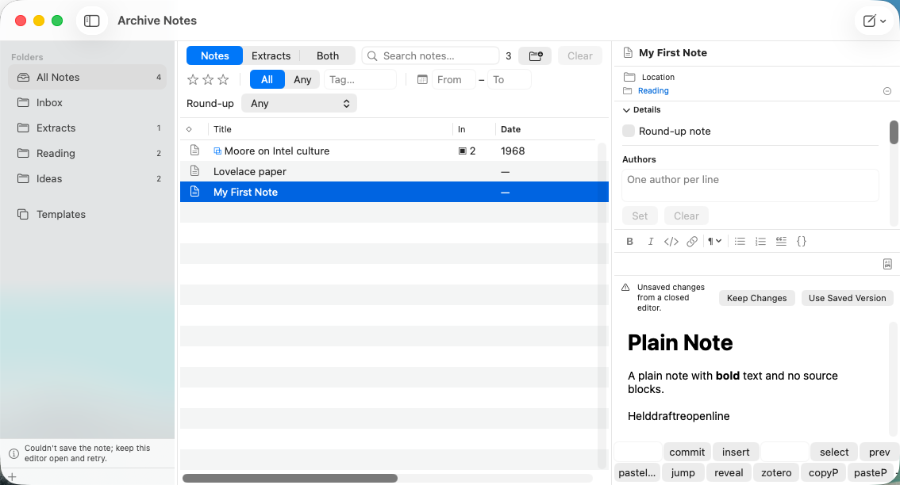

# W40.fix-notes-held-draft-reopen — reopen a refused draft

2026-11-01. Implementation checkpoint: `799fa1c7`; final change shortens the banner text.
Debug configuration; host unit-test app suppresses windows. GUI tests run in the headless Tart
`archive-gui-runner` VM, with the generated `AN-GUI-Fixture` scratch store, no corpus access,
no host screen and no shared clipboard. No paid APIs or rehearsal cache used.

A refused draft held by a closed editor now appears when its note opens again. Keep Changes saves it;
Use Saved Version discards it and its emergency copy. Typing accepts the shown draft. Ownership moves
only after any initial close-save or retry settles; changing selection during that wait consumes nothing.
A held draft of a note trashed in the app stops blocking quit once its emergency copy is durable.

Saved emergency copies are swept after the initial index load. Cleanup requires a receipt with the full
note UUID and SHA-256 of the original copy, unchanged copy bytes, and an identical current saved body.
Older receipt-less copies, user edits, templates' copies and copies of other/deleted notes stand.

Verification commands (all heavy work through the project lock, outside the Codex sandbox):

```sh
python3 ops/autonomous/heavy-run.py run -- bash ArchiveNotes/test-smoke.sh
ONLY_TESTING=ArchiveNotesUITests/WritingJourneyUITests ART_DIR=/tmp/notes-held-reopen-vm \
  python3 ops/autonomous/heavy-run.py run -- bash ops/gui/vm-gui-runner.sh notes xcuitest
ONLY_TESTING=ArchiveNotesUITests/WritingJourneyUITests/testHeldDraftIsShownWhenTheNoteOpensAgain \
  ART_DIR=/tmp/notes-held-reopen-final-vm \
  python3 ops/autonomous/heavy-run.py run -- bash ops/gui/vm-gui-runner.sh notes xcuitest
```

- Final host smoke (`smoke-notes-20261101-043526.log`): 240 XCTest tests and 1,060 Swift Testing tests
  in 104 suites pass. No new compiler warnings; existing AppIntents metadata-extraction warnings remain.
- `HeldDraftReopenTests`: 16 tests, including a parameterized success/refusal retry. Real scratch-store
  permission refusals exercise reopen/keep, use saved, an already-saved matching body, changed disk body,
  trash, cleanup, initial-close/retry suspension, superseded selection, stale TextKit writeback, full-ID
  collisions, and an edited copy whose text happens to equal the saved note.
- Independent adversarial review found discard/load, preparation/transfer, initial-close/retry, UUID-prefix
  and early-bootstrap hazards. Each was corrected and reviewed again; no implementation finding remains.
- Full VM WritingJourney suite at `799fa1c7`: **8/8 pass**, 0 failures, 211.899 seconds. Existing outside-edit,
  close, failed-save quit/retry, image-write, and immediate-quit/relaunch checks remain green.
- The new GUI test makes the note directory read-only, types `Helddraftreopenline`, switches to Templates,
  acknowledges the refused close, and reopens the same note. The held text and choice banner appear.
  Restoring writes and choosing Keep Changes saves the text, removes its copy and creates no Recovered draft.

Full-suite log excerpt:

```text
[W40-held-reopen] saved after keep = true
Executed 8 tests, with 0 failures (0 unexpected) in 211.899 seconds
** TEST SUCCEEDED **
```

Focused VM rerun with the final shorter banner: **1/1 pass**, 0 failures, 35.604 seconds. Screenshot
inspected: the held `Helddraftreopenline` is visible, the message fits in the narrow editor, and both
Keep Changes and Use Saved Version are readable. No new suite-process crash/hang report in either VM run.
Raw VM logs and result bundles remain under `/tmp/notes-held-reopen-vm/notes` and
`/tmp/notes-held-reopen-final-vm/notes`; the screenshot is retained here.



Limits: an externally removed note still refuses quit until Quit is chosen; its emergency copy stands.
Receipt-less old copies are preserved, with no migration. Templates' leftover copies are not swept.
