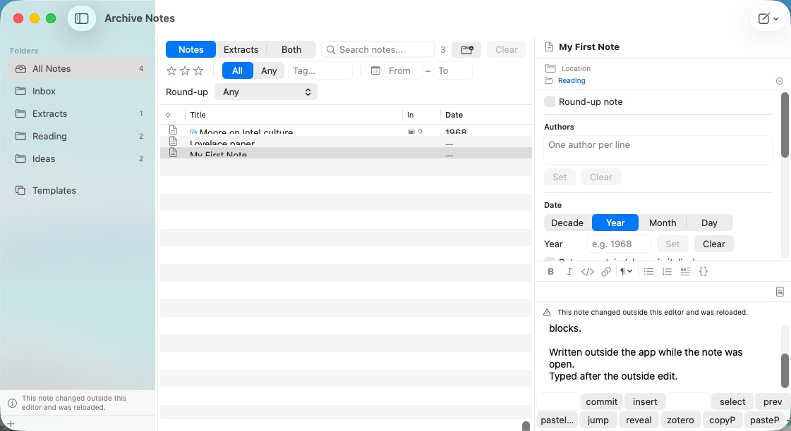
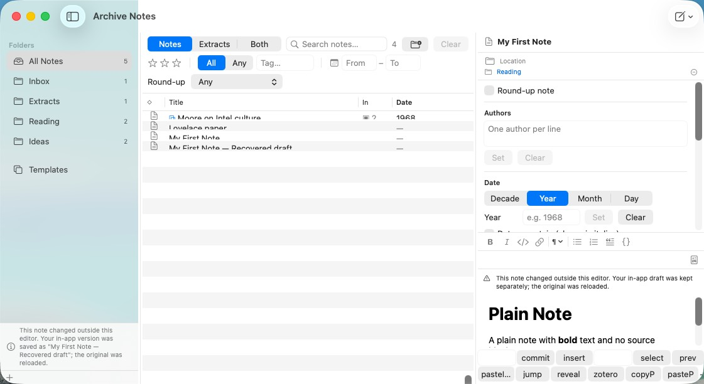

# W40.fix-notes-outside-edit-overwrite — outside changes and draft recovery

2026-10-15. Baseline: `de1f98dd`; implementation checkpoint: `81d1b663`.
Original reproduction: [W40.d9 writing session](W40.d9-writing.md), six VM runs losing an outside paragraph.

Open note/extract editors now keep their own loaded/saved body baseline. Every editor save compares it
against the current body inside a synchronous `NoteStore.saveBody` transaction with `NSFileCoordinator`.
Metadata-only changes compose with body edits. A clean editor checks its open note every second, reloads
an outside body change, clears the old TextKit undo/binding generation, and shows a notice.

When both versions changed, the original `.md` and its Finder metadata remain untouched. The complete
in-app draft becomes a new “Recovered draft” note, filed in Inbox (or Extracts). Pending pasted image
writes finish before copying its assets; contained asset symlinks are materialized so they resolve in the
new item. Only after that durable copy does the editor reload the original. New keystrokes received during
a save are flushed before deciding whether to reload; forced and idle saves share the same serial chain.

Verification:

- `bash ArchiveNotes/test-smoke.sh`: PASS, 969 Swift Testing tests in 95 suites plus 219 XCTest tests.
  Final host log: `smoke-notes-20261015-073717.log`; no new compiler warnings (the existing AppIntents
  metadata-extraction notices remain).
- `OutsideEditTests`: scratch in-place and atomic replacements, original byte identity, complete recovered
  body/assets, contained and escaping symlinks, pending pasted assets, front matter, independent editor
  baselines, failed recovery retaining the draft on selection and successful retry, index and membership.
- `NoteBodyEditorModelTests`: late TextKit keystrokes during save/read, retired same-note callbacks,
  overlapping forced flushes, and existing debounce/switch/quit regressions.
- Independent Tier-2 adversarial review found late TextKit, pending-asset and failed-switch identity
  hazards; all three were fixed and independently refuted. Final save-task-chain review found no open issue.
- VM, `ONLY_TESTING=ArchiveNotesUITests/WritingJourneyUITests ops/gui/vm-gui-runner.sh notes xcuitest`
  (2026-10-15 16:38 UTC): 5 of 5 pass, 0 unexpected, no `XCTExpectFailure` left; no UITest-build warnings.
  - `testEditOutsideTheAppWhileOpenIsNotSilentlyOverwritten` (the W40.d9 reproduction, 0 of 6 before):
    the clean editor reloaded the outside paragraph within 3 s, it survived the next autosave, and the
    sidebar said "This note changed outside this editor and was reloaded."
    
  - `testOutsideEditWithDirtyDraftKeepsBothVersions` (new): a recovery draft was written as
    "My First Note — Recovered draft", the original stayed byte-identical with the outside paragraph and
    was reloaded, both survived a relaunch, and the status line named the recovered note.
    
  - The other three writing-journey tests (autosave + ⌘Q + relaunch, window close, failed image write)
    still pass.

Limits: `NSFileCoordinator` serializes cooperating writers; it cannot make an arbitrary uncoordinated
process obey its transaction. The inherited close/quit path cannot reject a failed save: a refused
content/recovery write retains the dirty buffer while that editor lives, but closing/quitting after the
failure can still lose it. Confirmed and queued separately as **W40.fix-notes-failed-save-close** in both
trackers. This change makes no corpus writes and tests only temporary/VM fixture stores.
