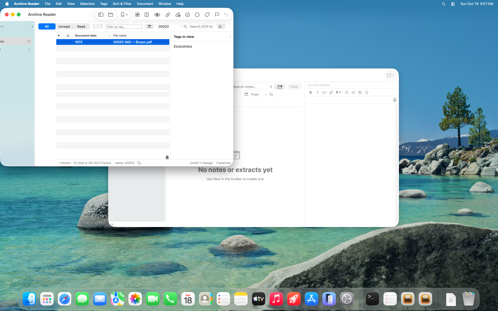

# W40.audit-ledger-undo — builder evidence, 2026-10-18

Baseline: 299ffc21. Prerequisite W40.fix-identity-url-cache shipped in d5133417.
R-46 is **fixed-pending-recheck**; this implementation session does not independently verify its own promise.

Undo now reads AuditLedger on model initialization, root changes and action boundaries. It offers the
latest **100 forward groups per main archive**, counting consumed groups in that bound so old actions
never resurface. Unsupported, malformed and unverified records are skipped; inverse-write records are
never redo candidates. Within a group, writes are reversed in reverse file order.

Every inverse first checks recorded device/inode, the bookmark when resolvable, a fresh FileIdentity,
and current main-archive containment. The shared writer checks the identity again inside coordination.
TagWriter binds the recorded inode to the object seen before and after the forward write; an uncertain
binding records no identity, and undo refuses that member. No identity check is silently disabled.

Before applying any inverse, a synchronized undoAttempt line consumes the whole group. Occurrence
inverses can append duplicate tokens, so an interrupted group is deliberately not replayed. Missing,
replaced, outside-root or unreadable members are reported by count and up to three filenames. No-op
inverses consume the action too. A consumption append failure changes no tags. Retry of individual
failed members remains outside this item (W40.fix-reader-undo-partial).

Forward recording is still best-effort: a recording failure now warns and disables older undo in that
process. On recovery a synchronized historyBarrier prevents crossing the gap, including on reopening
the ledger. A monotonic failure counter preserves the warning when storage recovers within a batch.
If the process dies while storage is still unavailable, the missing forward record and barrier cannot
be recovered. The ledger grows without bound on disk; ordinary forward lines are not fsynced. No
schema migration was written because there is no production app output to migrate.

## Scratch measurements and checks

- Reader smoke before the final review fixes: **456 tests passed**. The unit host is windowless.
- After both review fixes: **25 focused tests passed**, AuditLedgerTests (7), LedgerUndoHistoryTests
  (10), UndoDurabilityTests (8). Regressions cover relaunch plus a reopened ledger, grouped inverse
  order, concurrent unrelated tags and PDF bytes, duplicate occurrences and label restoration,
  replaced files, missing identity, conflicting/unavailable bookmarks, moved roots, other-root
  exclusion, malformed/unsupported/unverified records, the 100-group bound and non-resurrection,
  interruption before an inverse, no-op undo, consumption failure, forward-recording failure and
  recovery (including recovery within an action).
- 3,000 scratch files, one rename group: **6.525 s**; history reconstruction **0.284 s**;
  ledger **6,634,850 bytes**. 3,000 isolated appends of the same representative entry: **0.247 s**
  (3.8% of the full rename). Group append batching was not warranted by this measurement; bookmark,
  writer and identity work dominate. This measures synthetic local scratch, not a cloud corpus.
- Write-surface lint and its **22/22 mutation checks passed**.
- Separate read-only adversarial reviewer found forward-recording-gap replay and a recovery-within-
  batch warning gap. Both were reproduced in scratch regressions and fixed; final narrow review
  reported no remaining confirmed defects. The original relaunch assertion from W40.f1 is reversed:
  history is now required to survive model recreation, and the source is read afresh from disk.

Final full Reader smoke after checkpoint e4fe101c: **460 tests passed**, including all 25 focused
regressions. No new compiler warnings; the existing AppIntents metadata notices and scale test's
runtime QoS diagnostic remain. Log: `ArchiveReader/.maintenance/test-results/
smoke-reader-20261018-025320.log` (gitignored). Off-screen VM interaction check: **1 test passed**,
`NavigationUITests.testLedgerUndoShowsVerifiedResultOnScratchFixture`. It marks the generated scratch
PDF Read, clicks the real Undo toolbar, verifies the full tag multiset and unchanged PDF bytes,
checks “Undid 1 change.” and disabled Undo. Screenshot inspected: status and disabled control are
visible. Existing narrow-window clipping is outside this item (W40.fix-reader-narrow-window).
No host display interaction, real-corpus write, or paid call. The VM crash harvest found no new
suite crash or hang. Artifacts: `/private/tmp/W40-audit-undo-vm/reader/`.

